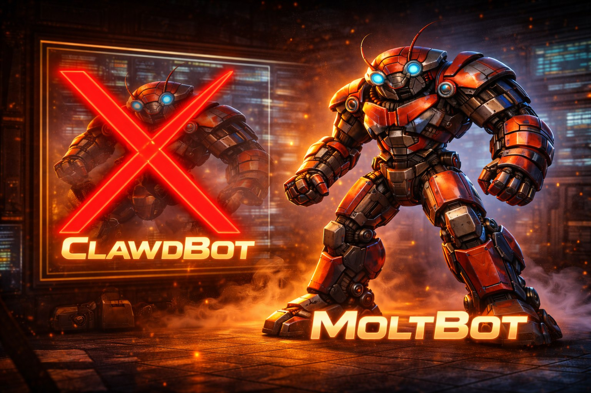
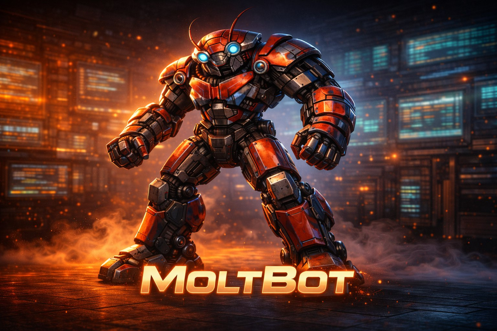

<p align="center">
  
</p>

# ê°Å¸Â¤â€“ Docker Moltbot

<div align="center">
  
  <p><strong>Arckhé AI</strong></p>
</div>


<p align="center">
  
</p>

[](https://www.docker.com/)
[](https://nodejs.org/)
[](LICENSE)
[](SECURITY.md)
[](https://docs.molt.bot)
[](https://discord.gg/clawd)

Setup Docker para o [Moltbot](https://molt.bot) ê¢â‚¬â€ um assistente pessoal de IA com seguranêƒÂ§a reforêƒÂ§ada de fêƒÂ¡brica.

> **Moltbot** (antigo Clawdbot) êƒÂ© um assistente de IA que roda na sua prêƒÂ³pria mêƒÂ¡quina. Ele se conecta a LLMs (Claude, GPT, Gemini, etc.), tem ferramentas (busca na web, execuêƒÂ§êƒÂ£o de cêƒÂ³digo, gerenciamento de arquivos, controle de navegador) e conversa com vocêƒÂª via Telegram, WhatsApp, Discord, webchat e mais. Este repo te dêƒÂ¡ um setup Docker pronto pra rodar com boas prêƒÂ¡ticas de seguranêƒÂ§a jêƒÂ¡ configuradas.

> ê¢Å¡Â ê¯Â¸Â **Nota (Jan 2026):** O rebrand para Moltbot estêƒÂ¡ em andamento. O pacote npm `moltbot` êƒÂ© atualmente um shim de compatibilidade. Este setup Docker instala o `clawdbot` (o runtime completo) e vai trocar automaticamente para `moltbot` quando o pacote completo for publicado. NêƒÂ£o precisa fazer nada ê¢â‚¬â€ êƒÂ© sêƒÂ³ rebuildar quando uma nova versêƒÂ£o for anunciada.

---

## ê¢Å“¨ Funcionalidades

- ê°Å¸â€â€™ **SeguranêƒÂ§a reforêƒÂ§ada** ê¢â‚¬â€ segue o [Checklist Top 10 de SeguranêƒÂ§a](SECURITY.md)
- ê°Å¸ÂÂ³ **Setup em um comando** ê¢â‚¬â€ `docker compose up -d`
- ê°Å¸â€Â **Secrets via variêƒÂ¡veis de ambiente** ê¢â‚¬â€ sem credenciais em texto puro nos arquivos de config
- ê°Å¸â€˜Â¤ **Container nêƒÂ£o-root** ê¢â‚¬â€ roda como usuêƒÂ¡rio sem privilêƒÂ©gios `moltbot`
- ê°Å¸â€œÂ **Logging habilitado** ê¢â‚¬â€ trilha de auditoria por padrêƒÂ£o
- ê°Å¸â€œÂ± **Multi-canal** ê¢â‚¬â€ Telegram, WhatsApp, Discord, Slack, webchat e mais
- ê°Å¸Å½â„¢ê¯Â¸Â **TranscriêƒÂ§êƒÂ£o de êƒÂ¡udio** ê¢â‚¬â€ Faster Whisper incluso (opcional)
- ê°Å¸â€ºÂ ê¯Â¸Â **Ferramentas integradas** ê¢â‚¬â€ acesso ao shell, busca na web, controle de navegador, execuêƒÂ§êƒÂ£o de cêƒÂ³digo
- ê°Å¸Â§Â  **200+ modelos via OpenRouter** ê¢â‚¬â€ Claude, GPT, Gemini, Llama, DeepSeek e mais com uma êƒÂºnica API key
- ê°Å¸ÂªÅ¸ **CompatêƒÂ­vel com Windows** ê¢â‚¬â€ `.gitattributes` forêƒÂ§a terminaêƒÂ§êƒÂµes LF, Dockerfile corrige CRLF
- ê°Å¸â€â€ž **Auto-restart** ê¢â‚¬â€ polêƒÂ­tica de reinêƒÂ­cio `unless-stopped`
- ê°Å¸Å’ **Rede segura** ê¢â‚¬â€ gateway vinculado ao loopback, isolamento de rede Docker disponêƒÂ­vel

---

## ê°Å¸â€œâ€¹ PrêƒÂ©-requisitos

| Plataforma | Requisito | InstalaêƒÂ§êƒÂ£o |
|------------|-----------|------------|
| **Windows** | Docker Desktop | [docker.com/products/docker-desktop](https://www.docker.com/products/docker-desktop/) |
| **Windows** | Git | [git-scm.com](https://git-scm.com/download/win) |
| **Mac** | Docker Desktop | [docker.com/products/docker-desktop](https://www.docker.com/products/docker-desktop/) |
| **Linux** | Docker Engine + Compose V2 | Ver instruêƒÂ§êƒÂµes abaixo |

---

## ê°Å¸ÂÂ³ InstalaêƒÂ§êƒÂ£o do Docker

### Windows

1. **Baixe o Docker Desktop:**
   - Acesse [docker.com/products/docker-desktop](https://www.docker.com/products/docker-desktop/)
   - Clique em "Download for Windows"

2. **Execute o instalador:**
   - Abra o arquivo `.exe` baixado
   - Aceite os termos e siga o wizard de instalaêƒÂ§êƒÂ£o
   - O instalador vai pedir para habilitar o **WSL 2** ê¢â‚¬â€ aceite

3. **Reinicie o computador** (se solicitado)

4. **Inicie o Docker Desktop:**
   - Abra pelo menu Iniciar
   - Espere atêƒÂ© aparecer "Docker is running" (êƒÂ­cone ê°Å¸ÂÂ³ na bandeja do sistema)

5. **Verifique a instalaêƒÂ§êƒÂ£o:**
   ```powershell
   docker --version
   docker compose version
   ```

> ê¢Å¡Â ê¯Â¸Â **WSL 2 nêƒÂ£o instalado?** Se o Docker Desktop pedir para instalar o WSL 2, siga as instruêƒÂ§êƒÂµes na tela. Isso êƒÂ© necessêƒÂ¡rio para rodar containers Linux no Windows.

> ê¢Å¡Â ê¯Â¸Â **Erro "WSL docker-desktop Stopped"?** Abra o Docker Desktop pelo menu Iniciar ê¢â‚¬â€ ele inicia o WSL automaticamente.

### Linux (Ubuntu/Debian)

O Docker Compose V2 jêƒÂ¡ vem integrado ao Docker Engine (comando `docker compose`, sem hêƒÂ­fen).

1. **Instale o Docker** (script oficial):
   ```bash
   curl -fsSL https://get.docker.com | sh
   ```

2. **Inicie o serviêƒÂ§o:**
   ```bash
   sudo systemctl start docker
   ```

3. **Habilite no boot:**
   ```bash
   sudo systemctl enable docker
   ```

4. **Verifique se estêƒÂ¡ rodando:**
   ```bash
   sudo systemctl status docker
   ```
   > Deve mostrar `Active: active (running)`. Pressione `q` para sair.

5. **Adicione seu usuêƒÂ¡rio ao grupo docker** (para rodar sem `sudo`):
   ```bash
   sudo usermod -aG docker $USER
   ```

6. **FaêƒÂ§a logout e login novamente** para aplicar a mudanêƒÂ§a

7. **Verifique a instalaêƒÂ§êƒÂ£o:**
   ```bash
   docker --version
   docker compose version
   docker ps  # Deve mostrar lista vazia (sem erro)
   ```

### Linux (Alternativa: via apt)

Se preferir usar o pacote do Ubuntu (pode ser versêƒÂ£o mais antiga):

```bash
sudo apt update
sudo apt install -y docker.io
sudo systemctl start docker
sudo systemctl enable docker
sudo systemctl status docker  # Verificar se estêƒÂ¡ rodando
sudo usermod -aG docker $USER
# FaêƒÂ§a logout e login novamente
```

### Mac

1. **Baixe o Docker Desktop:**
   - Acesse [docker.com/products/docker-desktop](https://www.docker.com/products/docker-desktop/)
   - Escolha a versêƒÂ£o para seu chip (Intel ou Apple Silicon)

2. **Arraste para Applications** e abra o Docker Desktop

3. **Verifique a instalaêƒÂ§êƒÂ£o:**
   ```bash
   docker --version
   docker compose version
   ```

### Subindo o Container (Linux/Mac)

ApêƒÂ³s instalar o Docker, siga estes passos para colocar o Moltbot no ar:

1. **Clone o repositêƒÂ³rio:**
   ```bash
   git clone https://github.com/linnoff88-dev/docker-moltbot-open.git
   cd docker-moltbot-open
   ```

2. **Configure o arquivo `.env`:**
   ```bash
   cp .env.example .env
   nano .env  # ou use seu editor preferido
   ```

3. **Preencha as variêƒÂ¡veis obrigatêƒÂ³rias no `.env`:**
   ```env
   GATEWAY_AUTH_TOKEN=seu-token-seguro-aqui    # Gere com: openssl rand -hex 24
   OPENROUTER_API_KEY=sk-or-v1-sua-chave-aqui  # Obtenha em openrouter.ai/keys
   ```

4. **Configure canais de mensagem** (opcional):
   ```env
   # Telegram - crie um bot com @BotFather no Telegram
   TELEGRAM_BOT_TOKEN=123456:ABC-seu-token-do-botfather
   ```

5. **Suba o container:**
   ```bash
   docker compose up -d
   ```

6. **Verifique se estêƒÂ¡ rodando:**
   ```bash
   docker compose ps      # Status do container
   docker compose logs    # Ver logs (Ctrl+C para sair)
   ```

7. **Configure o WhatsApp** (opcional):
   ```bash
   docker exec -it moltbot clawdbot channels login whatsapp
   # Escaneie o QR code com seu celular
   ```

8. **Acesse o webchat:**
   ```
   http://localhost:18789/chat
   ```
   > Use o `GATEWAY_AUTH_TOKEN` que vocêƒÂª configurou no `.env` para autenticar.

> ê°Å¸â€™Â¡ Veja as seêƒÂ§êƒÂµes [ConfiguraêƒÂ§êƒÂ£o do Telegram](#-configuraêƒÂ§êƒÂ£o-do-telegram) e [ConfiguraêƒÂ§êƒÂ£o do WhatsApp](#-configuraêƒÂ§êƒÂ£o-do-whatsapp) para instruêƒÂ§êƒÂµes detalhadas.

---

## ê°Å¸Å¡â‚¬ InêƒÂ­cio RêƒÂ¡pido

### Passo 1: Clone o repo

**Linux / Mac:**
```bash
git clone https://github.com/linnoff88-dev/docker-moltbot-open.git
cd docker-moltbot-open
```

**Windows (CMD):**
```cmd
git clone https://github.com/linnoff88-dev/docker-moltbot-open.git
cd docker-moltbot-open
```

**Windows (PowerShell):**
```powershell
git clone https://github.com/linnoff88-dev/docker-moltbot-open.git
cd docker-moltbot-open
```

### Passo 2: Configure o ambiente

**Linux / Mac:**
```bash
cp .env.example .env
nano .env  # Fill in your API keys
```

**Windows (CMD):**
```cmd
copy .env.example .env
notepad .env
```

**Windows (PowerShell):**
```powershell
Copy-Item .env.example .env
notepad .env
```

> ê¢Å¡Â ê¯Â¸Â **IMPORTANTE:** VocêƒÂª **PRECISA** criar E editar o arquivo `.env` antes de rodar `docker compose up`. O container nêƒÂ£o vai funcionar com os valores de exemplo.

Abra o arquivo `.env` e substitua os valores de exemplo pelas suas chaves reais:

```env
# ê¢ÂÅ’ ERRADO ê¢â‚¬â€ esses sêƒÂ£o placeholders, nêƒÂ£o vêƒÂ£o funcionar:
OPENROUTER_API_KEY=sk-or-your-key-here
GATEWAY_AUTH_TOKEN=your-secure-token-here

# ê¢Å“… CERTO ê¢â‚¬â€ suas chaves reais:
OPENROUTER_API_KEY=sk-or-v1-abc123-your-actual-real-key
GATEWAY_AUTH_TOKEN=a1b2c3d4e5f6a1b2c3d4e5f6a1b2c3d4e5f6a1b2c3d4e5f6
DEFAULT_MODEL=openrouter/anthropic/claude-sonnet-4.5
```

### Passo 3: Gere um token seguro para o gateway

O `GATEWAY_AUTH_TOKEN` protege a API do seu gateway contra acesso nêƒÂ£o autorizado. Gere um aleatêƒÂ³rio:

**Linux / Mac:**
```bash
openssl rand -hex 24
```

**Windows (PowerShell):**
```powershell
-join ((1..48) | ForEach-Object { '{0:x}' -f (Get-Random -Max 16) })
```

**Ou** use qualquer string aleatêƒÂ³ria longa (pelo menos 24 caracteres). VocêƒÂª pode usar um gerenciador de senhas para gerar uma.

Copie o token gerado para o seu arquivo `.env` como `GATEWAY_AUTH_TOKEN`.

### Passo 4: Configure sua chave OpenRouter

Este setup usa **OpenRouter** como gateway unificado de LLMs. Com uma êƒÂºnica API key, vocêƒÂª tem acesso a 200+ modelos:

| Categoria | Modelos DisponêƒÂ­veis |
|-----------|---------------------|
| **Claude** | Sonnet 4.5, Opus 4, Haiku 3.5, etc. |
| **GPT** | GPT-4o, GPT-4 Turbo, o1-preview, etc. |
| **Gemini** | Gemini 2.0 Flash (FREE), Pro, etc. |
| **Open Source** | Llama 3.3 70B (FREE), DeepSeek R1 (FREE), Qwen, etc. |
| **Especializados** | Mistral, Claude, Grok, e mais |

**Obtenha sua chave:**
1. Acesse [openrouter.ai](https://openrouter.ai/)
2. FaêƒÂ§a login com Google/GitHub
3. VêƒÂ¡ para [Keys](https://openrouter.ai/keys) e crie uma nova API key
4. Copie a key (comeêƒÂ§a com `sk-or-v1-...`)
5. Cole no seu `.env` como `OPENROUTER_API_KEY`

**Escolha seu modelo padrêƒÂ£o:**

Edite `DEFAULT_MODEL` no `.env` para escolher qual modelo usar.

ê¢Å¡Â ê¯Â¸Â **IMPORTANTE:** O formato correto êƒÂ© `openrouter/<provider>/<model>` (com o prefixo `openrouter/`)

```env
# OpêƒÂ§êƒÂ£o 1: Claude Sonnet 4.5 (melhor qualidade, recomendado) ê¢Â­Â
DEFAULT_MODEL=openrouter/anthropic/claude-sonnet-4.5

# OpêƒÂ§êƒÂ£o 2: Claude 3.5 Sonnet (êƒÂ³timo custo-benefêƒÂ­cio)
DEFAULT_MODEL=openrouter/anthropic/claude-3.5-sonnet

# OpêƒÂ§êƒÂ£o 3: GPT-4o (excelente para cêƒÂ³digo)
DEFAULT_MODEL=openrouter/openai/gpt-4o

# OpêƒÂ§êƒÂ£o 4: Gemini 2.0 Flash (GRêƒÂTIS, muito rêƒÂ¡pido) ê°Å¸â€ â€œ
DEFAULT_MODEL=openrouter/google/gemini-2.0-flash-exp

# OpêƒÂ§êƒÂ£o 5: Llama 3.3 70B (GRêƒÂTIS, open source) ê°Å¸â€ â€œ
DEFAULT_MODEL=openrouter/meta-llama/llama-3.3-70b-instruct

# OpêƒÂ§êƒÂ£o 6: DeepSeek R1 (GRêƒÂTIS, raciocêƒÂ­nio avanêƒÂ§ado) ê°Å¸â€ â€œ
DEFAULT_MODEL=openrouter/deepseek/deepseek-r1
```

> ê¢Å¡Â ê¯Â¸Â **ATENêƒâ€¡êƒÆ’O:** NêƒÆ’O esqueêƒÂ§a do prefixo `openrouter/` no inêƒÂ­cio! Sem ele o modelo nêƒÂ£o serêƒÂ¡ reconhecido.

> ê°Å¸â€™Â¡ **Dica:** VocêƒÂª pode trocar de modelo a qualquer momento editando o `.env` e executando:
> ```bash
> docker compose down -v && docker compose up -d
> ```

> ê°Å¸â€™Â° **Modelos GrêƒÂ¡tis:** Gemini 2.0 Flash, Llama 3.3 70B e DeepSeek R1 sêƒÂ£o totalmente gratuitos no OpenRouter. Perfeito para testar!

> ê°Å¸â€œÅ  **PreêƒÂ§os e limites:** Consulte [openrouter.ai/models](https://openrouter.ai/models) para ver preêƒÂ§os, limites de contexto e velocidade de cada modelo.

> ê°Å¸â€œâ€“ **Guia completo:** Ver [SETUP-OPENROUTER.md](SETUP-OPENROUTER.md) para troubleshooting e mais opêƒÂ§êƒÂµes de modelos.

### Passo 5: Build e execuêƒÂ§êƒÂ£o

```bash
docker compose up -d
```

> ê°Å¸â€™Â¡ **Primeira execuêƒÂ§êƒÂ£o** leva alguns minutos para buildar a imagem (baixa Node.js, FFmpeg, Python, etc). As execuêƒÂ§êƒÂµes seguintes iniciam instantaneamente.

> ê¢Å¡Â ê¯Â¸Â **Erro no Windows `open //./pipe/dockerDesktopLinuxEngine`?** O Docker Desktop nêƒÂ£o estêƒÂ¡ rodando. Abra-o pelo menu Iniciar e espere atêƒÂ© mostrar "Docker is running", depois tente novamente.

> ê¢Å“¨ **ConfiguraêƒÂ§êƒÂ£o automêƒÂ¡tica:** O script `entrypoint.sh` detecta automaticamente qual provedor de LLM vocêƒÂª configurou no `.env` e cria a configuraêƒÂ§êƒÂ£o ideal. VocêƒÂª **nêƒÂ£o precisa** editar arquivos JSON manualmente!

### Passo 6: Acesse o Webchat

Abra no seu navegador:
```
http://localhost:18789/chat
```

Quando solicitado, digite seu `GATEWAY_AUTH_TOKEN` do arquivo `.env` para autenticar.

> ê°Å¸â€™Â¡ **Dica:** VocêƒÂª tambêƒÂ©m pode acessar diretamente com: `http://localhost:18789/?token=SEU_TOKEN`

### Passo 7: Verifique o status

```bash
# Acompanhe os logs (Ctrl+C para parar)
docker compose logs -f

# Ou veja sêƒÂ³ as êƒÂºltimas 50 linhas
docker compose logs --tail 50
```

VocêƒÂª deve ver uma saêƒÂ­da como:
```
ê°Å¸Â¤â€“ First run ê¢â‚¬â€ creating config from template...
ê°Å¸â€â€˜ Setting gateway auth token...
ê°Å¸â€œÂ± Enabling Telegram...
ê°Å¸Å’ Setting gateway bind to lan (required for Docker port mapping)...
ê°Å¸â€œÂ Enabling logging...
ê°Å¸Â¤â€“ Starting Moltbot...
```

### Passo 8: ConfiguraêƒÂ§êƒÂ£o pêƒÂ³s-instalaêƒÂ§êƒÂ£o

Depois que o container estiver rodando, use esses comandos para ajustar seu setup:

```bash
# Auto-detecte e corrija problemas de config
docker exec moltbot clawdbot doctor --fix

# Verifique a saêƒÂºde geral
docker exec moltbot clawdbot status

# Execute uma auditoria de seguranêƒÂ§a
docker exec moltbot clawdbot security audit
```

| Comando | O que faz |
|---------|-----------|
| `clawdbot doctor --fix` | Auto-detecta e corrige problemas de config (ex: Telegram configurado mas nêƒÂ£o habilitado) |
| `clawdbot doctor` | Mesma verificaêƒÂ§êƒÂ£o, mas sêƒÂ³ **mostra** os problemas sem corrigir |
| `clawdbot status` | Mostra status do gateway, canais conectados, info do modelo |
| `clawdbot security audit` | Verifica seu setup contra boas prêƒÂ¡ticas de seguranêƒÂ§a |

> ê°Å¸â€™Â¡ **Nota:** O comando CLI ainda êƒÂ© `clawdbot` nesta versêƒÂ£o (2026.1.24-3). A migraêƒÂ§êƒÂ£o para `moltbot` estêƒÂ¡ em andamento.

---

## ê°Å¸â€œÂ± ConfiguraêƒÂ§êƒÂ£o do Telegram

O Telegram êƒÂ© a forma mais fêƒÂ¡cil de falar com seu Moltbot de qualquer lugar.

### Passo a passo:

1. **Crie um bot** ê¢â‚¬â€ Abra o Telegram e mande mensagem pro [@BotFather](https://t.me/BotFather)
2. **Envie `/newbot`** ê¢â‚¬â€ Siga as instruêƒÂ§êƒÂµes para nomear seu bot
3. **Copie o token** ê¢â‚¬â€ O BotFather te dêƒÂ¡ um token tipo `123456:ABC-DEF1234ghIkl-zyx57W2v1u123ew11`
4. **Adicione ao `.env`:**
   ```env
   TELEGRAM_BOT_TOKEN=123456:ABC-DEF1234ghIkl-zyx57W2v1u123ew11
   ```
5. **Reinicie o container:**
   ```bash
   docker compose restart
   ```
6. **Mande mensagem pro seu bot** no Telegram ê¢â‚¬â€ ele vai te dar um **cêƒÂ³digo de pareamento**
7. **Aprove o pareamento** dentro do container:
   ```bash
   docker exec moltbot clawdbot pairing approve telegram <code>
   ```

> ê°Å¸â€™Â¡ O sistema de pareamento garante que sêƒÂ³ usuêƒÂ¡rios aprovados possam falar com seu bot. êƒâ€° uma funcionalidade de seguranêƒÂ§a ê¢â‚¬â€ sem aprovaêƒÂ§êƒÂ£o, o bot nêƒÂ£o responde a estranhos.

### Opcional: Configure as opêƒÂ§êƒÂµes do BotFather

Ainda no BotFather, vocêƒÂª tambêƒÂ©m pode:
- `/setdescription` ê¢â‚¬â€ Adicionar uma descriêƒÂ§êƒÂ£o pro seu bot
- `/setabouttext` ê¢â‚¬â€ Adicionar texto "Sobre"
- `/setuserpic` ê¢â‚¬â€ Definir uma foto de perfil
- `/setcommands` ê¢â‚¬â€ Definir comandos do bot (opcional)

---

## ê°Å¸â€œÂ² ConfiguraêƒÂ§êƒÂ£o do WhatsApp

VocêƒÂª pode conectar o Moltbot ao WhatsApp via pareamento por QR code.

### Passo a passo:

1. **Execute o comando de login:**
   ```bash
   docker exec -it moltbot clawdbot channels login whatsapp
   ```
2. **Escaneie o QR code** com seu WhatsApp (ConfiguraêƒÂ§êƒÂµes ê¢â€ â€™ Aparelhos Conectados ê¢â€ â€™ Conectar um Aparelho)
3. **Pronto!** Seu Moltbot agora estêƒÂ¡ conectado ao WhatsApp

### ê¢Å¡Â ê¯Â¸Â NêƒÂºmero Pessoal vs. NêƒÂºmero Dedicado

**Usando seu nêƒÂºmero pessoal:**
- O bot vai ver mensagens de todos os seus contatos
- Por padrêƒÂ£o, a polêƒÂ­tica de DM êƒÂ© `pairing` ê¢â‚¬â€ outros podem receber um prompt de pareamento
- **Recomendado:** Defina `dmPolicy: allowlist` com apenas o seu nêƒÂºmero:

```json
{
  "channels": {
    "whatsapp": {
      "selfChatMode": true,
      "dmPolicy": "allowlist",
      "allowFrom": ["+5511999999999"]
    }
  }
}
```

**Usando um nêƒÂºmero dedicado (recomendado):**
- Pegue um chip prêƒÂ©-pago barato ou um nêƒÂºmero do Google Voice
- Instale o WhatsApp num celular secundêƒÂ¡rio ou use o WhatsApp Web
- SeparaêƒÂ§êƒÂ£o mais limpa entre mensagens pessoais e do bot

> ê°Å¸â€™Â¡ **Modo self-chat:** Fale consigo mesmo no WhatsApp ê¢â‚¬â€ mensagens para o seu prêƒÂ³prio nêƒÂºmero vêƒÂ£o pro Moltbot. NinguêƒÂ©m mais êƒÂ© afetado.

---

## ê°Å¸â€â€™ SeguranêƒÂ§a

Este setup Docker implementa **7 de 10** medidas de hardening de seguranêƒÂ§a automaticamente. Veja o [SECURITY.md](SECURITY.md) para o checklist completo.

### O que o Docker faz automaticamente:
| ProteêƒÂ§êƒÂ£o | Status |
|----------|--------|
| Gateway vinculado apenas ao `127.0.0.1` (lado do host) | ê¢Å“… AutomêƒÂ¡tico |
| PolêƒÂ­tica de DM requer aprovaêƒÂ§êƒÂ£o de pareamento | ê¢Å“… AutomêƒÂ¡tico |
| Arquivos de config com `chmod 600` | ê¢Å“… AutomêƒÂ¡tico |
| Container roda como usuêƒÂ¡rio nêƒÂ£o-root | ê¢Å“… AutomêƒÂ¡tico |
| Sem escalaêƒÂ§êƒÂ£o de privilêƒÂ©gios (`no-new-privileges`) | ê¢Å“… AutomêƒÂ¡tico |
| Logging e diagnêƒÂ³sticos habilitados | ê¢Å“… AutomêƒÂ¡tico |
| Secrets via variêƒÂ¡veis de ambiente | ê¢Å“… AutomêƒÂ¡tico |

### O que VOCêƒÅ  deve fazer:
- [ ] Configurar o `AGENTS.md` para bloquear comandos perigosos (veja [SECURITY.md](SECURITY.md))
- [ ] Revisar o acesso a ferramentas MCP e restringir ao mêƒÂ­nimo necessêƒÂ¡rio
- [ ] Considerar rede `internal: true` se nêƒÂ£o precisar de internet (bloqueia chamadas de API tambêƒÂ©m)

### Auditoria de seguranêƒÂ§a:
```bash
docker exec moltbot clawdbot security audit
```

### Modelo de ameaêƒÂ§as (simplificado)

**O que o Moltbot pode fazer:**
- Executar comandos shell no container
- Ler/escrever arquivos no workspace
- Fazer requisiêƒÂ§êƒÂµes HTTP (chamadas de API, busca na web)
- Controlar um navegador (se configurado)
- Enviar mensagens nos canais conectados

**O que atacantes podem tentar:**
- **InjeêƒÂ§êƒÂ£o de prompt:** Enganar o bot via conteêƒÂºdo web ou mensagens maliciosas
- **Escape de shell:** Fazer o bot rodar comandos perigosos (`rm -rf /`, `curl | bash`)
- **Roubo de token:** Roubar chaves de API dos configs ou logs
- **Acesso nêƒÂ£o autorizado:** Mandar mensagem pro bot sem aprovaêƒÂ§êƒÂ£o
- **ExposiêƒÂ§êƒÂ£o de rede:** Acessar o gateway de fora do localhost

### Vulnerabilidades comuns e mitigaêƒÂ§êƒÂµes:

| Vulnerabilidade | Risco | MitigaêƒÂ§êƒÂ£o |
|----------------|-------|-----------|
| **InjeêƒÂ§êƒÂ£o de prompt** | MêƒÂ©dio | Moltbot envolve conteêƒÂºdo nêƒÂ£o-confiêƒÂ¡vel em tags de seguranêƒÂ§a; configure o AGENTS.md para bloquear padrêƒÂµes perigosos |
| **Acesso ao shell** | MêƒÂ©dio | Isolamento do container + usuêƒÂ¡rio nêƒÂ£o-root; bloqueie `rm -rf`, `curl \| bash` no AGENTS.md |
| **Logs de sessêƒÂ£o em texto puro** | Baixo | Logs ficam dentro de volumes Docker com permissêƒÂµes restritas; habilite `redactSensitive` na config |
| **Plugins nêƒÂ£o verificados** | Baixo | Instale plugins apenas de fontes confiêƒÂ¡veis; revise permissêƒÂµes de ferramentas MCP |
| **WhatsApp com nêƒÂºmero pessoal** | MêƒÂ©dio | Use dmPolicy `allowlist` ou um nêƒÂºmero dedicado |
| **ExposiêƒÂ§êƒÂ£o de rede** | Baixo | Gateway vinculado a 127.0.0.1; use têƒÂºnel SSH ou Tailscale para acesso remoto |
| **Controle de navegador** | MêƒÂ©dio | Navegador roda em sandbox; restrinja apenas a sites confiêƒÂ¡veis |

---

## ê°Å¸â€œÂ¦ Volumes

Volumes Docker persistem seus dados entre reinêƒÂ­cios e rebuilds do container.

| Volume | Caminho no Container | Finalidade |
|--------|---------------------|------------|
| `moltbot-data` | `/home/moltbot/.clawdbot` | Config, dados de sessêƒÂ£o, tokens de auth, info de pareamento |
| `moltbot-workspace` | `/home/moltbot/workspace` | Workspace do agente ê¢â‚¬â€ AGENTS.md, arquivos de memêƒÂ³ria, arquivos de projeto |
| `moltbot-logs` | `/home/moltbot/logs` | Arquivos de log (NêƒÆ’O em /tmp ê¢â‚¬â€ sobrevive a reinêƒÂ­cios) |

> ê°Å¸â€™Â¡ **Nota:** O diretêƒÂ³rio de config ainda êƒÂ© `~/.clawdbot` nesta versêƒÂ£o. SerêƒÂ¡ migrado para `~/.moltbot` em versêƒÂµes futuras.

### FaêƒÂ§a backup dos seus dados:
```bash
# Backup de todos os volumes
docker run --rm -v moltbot-data:/data -v $(pwd):/backup alpine tar czf /backup/moltbot-data.tar.gz -C /data .
docker run --rm -v moltbot-workspace:/data -v $(pwd):/backup alpine tar czf /backup/moltbot-workspace.tar.gz -C /data .
```

### Resetar tudo:
```bash
docker compose down -v  # ê¢Å¡Â ê¯Â¸Â Apaga TODOS os dados incluindo config e workspace
```

---

## ê°Å¸â€ºÂ ê¯Â¸Â Comandos êƒÅ¡teis

```bash
# === Ciclo de vida ===
docker compose up -d              # Start in background
docker compose down               # Stop and remove container
docker compose restart            # Restart
docker compose stop               # Stop without removing

# === Logs ===
docker compose logs -f            # Follow logs (Ctrl+C to stop)
docker compose logs --tail 100    # Last 100 lines

# === Acesso ao shell ===
docker compose exec moltbot bash  # Open shell inside container

# === Clawdbot CLI ===
docker exec moltbot clawdbot status          # Gateway status
docker exec moltbot clawdbot doctor --fix    # Auto-fix issues
docker exec moltbot clawdbot security audit  # Security check

# === Atualizar Moltbot ===
docker compose build --no-cache   # Rebuild image (pulls latest moltbot)
docker compose up -d              # Restart with new image

# === Limpeza ===
docker system prune -a            # Remove unused images (reclaim disk space)
```

---

## ê°Å¸Å’ Isolamento de Rede

Por padrêƒÂ£o, o container tem acesso êƒÂ  internet ê¢â‚¬â€ isso êƒÂ© **necessêƒÂ¡rio** para chamadas de API êƒÂ  Anthropic, OpenAI, etc.

### Isolamento total (sem internet):
```yaml
# No docker-compose.yml, altere:
networks:
  moltbot-net:
    internal: true  # No internet access
```

> ê¢Å¡Â ê¯Â¸Â **AtenêƒÂ§êƒÂ£o:** Isso bloqueia TODAS as conexêƒÂµes de saêƒÂ­da, incluindo chamadas de API para provedores de LLM. Use apenas se vocêƒÂª tiver um **setup de modelo local** (ex: Ollama rodando na mesma rede).

### Isolamento parcial (permitir apenas hosts especêƒÂ­ficos):
Para usuêƒÂ¡rios avanêƒÂ§ados, use polêƒÂ­ticas de rede Docker ou regras iptables para permitir apenas endpoints de API especêƒÂ­ficos.

---

## ê°Å¸â€œÂ¡ Canais de Acesso

O Moltbot suporta mêƒÂºltiplos canais de comunicaêƒÂ§êƒÂ£o simultaneamente. Todos os canais compartilham o mesmo agente, memêƒÂ³ria e workspace.

| Canal | Tipo | Acesso | Dificuldade de Setup | Melhor Para |
|-------|------|--------|---------------------|-------------|
| ê°Å¸â€œÂ± **Telegram** | Mensagens | Qualquer lugar (mobile/desktop) | ê¢Â­Â FêƒÂ¡cil | Uso diêƒÂ¡rio, acesso rêƒÂ¡pido |
| ê°Å¸â€œÂ² **WhatsApp** | Mensagens | Qualquer lugar (mobile/desktop) | ê¢Â­Â FêƒÂ¡cil | Se vocêƒÂª jêƒÂ¡ usa WhatsApp |
| ê°Å¸â€™Â¬ **Webchat** | Interface Web | Rede local / VPN | ê¢Â­Â FêƒÂ¡cil | Interface rica, upload de arquivos |
| ê°Å¸Å’ **Webchat (pêƒÂºblico)** | Interface Web | Qualquer lugar | ê¢Â­Âê¢Â­Âê¢Â­Â AvanêƒÂ§ado | Bot pêƒÂºblico |
| ê°Å¸â€â€™ **Tailscale** | VPN | Qualquer lugar (zero-trust) | ê¢Â­Âê¢Â­Â MêƒÂ©dio | Acesso remoto mais seguro |
| ê°Å¸â€™Å“ **Discord** | Mensagens | Qualquer lugar | ê¢Â­Âê¢Â­Â MêƒÂ©dio | Times, comunidades |
| ê°Å¸â€™Â¼ **Slack** | Mensagens | Qualquer lugar | ê¢Â­Âê¢Â­Â MêƒÂ©dio | Trabalho/empresarial |
| ê°Å¸â€Âµ **Signal** | Mensagens | Qualquer lugar | ê¢Â­Âê¢Â­Âê¢Â­Â AvanêƒÂ§ado | Privacidade mêƒÂ¡xima |
| ê°Å¸Å¸Â¢ **Matrix** | Mensagens | Qualquer lugar | ê¢Â­Âê¢Â­Âê¢Â­Â AvanêƒÂ§ado | Self-hosted, federado |

### Qual devo usar?

- **Setup mais simples:** Telegram ê¢â‚¬â€ um token de bot e pronto
- **Mais privado:** Signal ou Tailscale + Webchat
- **Acesso de qualquer lugar sem apps extras:** Telegram + WhatsApp (vocêƒÂª jêƒÂ¡ tem)
- **Melhor para times/trabalho:** Slack ou Discord
- **Webchat remoto mais seguro:** Tailscale ê¢â‚¬â€ VPN zero-trust, sem portas abertas

### Multi-canal

VocêƒÂª pode habilitar **mêƒÂºltiplos canais simultaneamente**. Todos os canais compartilham o mesmo agente, memêƒÂ³ria e workspace. Mensagens de qualquer canal chegam no mesmo assistente.

> ê¢Å¡Â ê¯Â¸Â **Mensagens entre canais sêƒÂ£o restritas** por design ê¢â‚¬â€ o bot nêƒÂ£o vai vazar dados de conversa entre canais.

---

## ê°Å¸â€“Â¥ê¯Â¸Â Acesso ao Webchat (Remoto)

O gateway êƒÂ© vinculado ao `127.0.0.1` (apenas loopback). Para acessar o webchat de outra mêƒÂ¡quina, use um **têƒÂºnel SSH**:

```bash
# Na sua mêƒÂ¡quina local (a que tem o navegador):
ssh -L 18789:localhost:18789 user@your-server-ip

# Depois abra no navegador:
# http://127.0.0.1:18789/chat
```

Esta êƒÂ© a forma mais segura de acessar a interface web remotamente ê¢â‚¬â€ sem portas expostas, todo trêƒÂ¡fego criptografado via SSH.

### Alternativa: Tailscale (recomendado para uso frequente)

Se vocêƒÂª acessa o webchat com frequêƒÂªncia, configure o [Tailscale](https://tailscale.com) para acesso VPN transparente:

```bash
# No seu servidor:
curl -fsSL https://tailscale.com/install.sh | sh
sudo tailscale up

# Nos seus dispositivos:
# Instale o app Tailscale, faêƒÂ§a login com a mesma conta
# Acesse o webchat via: http://<tailscale-ip>:18789/chat
```

---

## ê°Å¸Â§Â° Ferramentas e Skills Recomendados

Turbine seu Moltbot com estas ferramentas adicionais:

### ê°Å¸â€ºÂ  Ferramentas CLI

| Ferramenta | InstalaêƒÂ§êƒÂ£o | Finalidade |
|------------|------------|------------|
| FFmpeg | PrêƒÂ©-instalado na imagem Docker | Processamento de êƒÂ¡udio/vêƒÂ­deo |
| Faster Whisper | PrêƒÂ©-instalado na imagem Docker | TranscriêƒÂ§êƒÂ£o local de êƒÂ¡udio |

> ê¢â€žÂ¹ê¯Â¸Â **Nota:** Ferramentas como Codex CLI e agent-browser sêƒÂ£o para outros frameworks e nêƒÂ£o sêƒÂ£o compatêƒÂ­veis com este projeto Moltbot.

### ê°Å¸Å½Â¨ ServiêƒÂ§os de API

| ServiêƒÂ§o | Finalidade | PreêƒÂ§o |
|---------|------------|-------|
| [OpenRouter](https://openrouter.ai) | Gateway para mêƒÂºltiplos LLMs (modelos gratuitos disponêƒÂ­veis) | Tier gratuito + pay-per-use |
| [Kie.ai](https://kie.ai) | GeraêƒÂ§êƒÂ£o de imagem, vêƒÂ­deo e mêƒÂºsica (Veo 3.1, Flux, Suno) | CrêƒÂ©ditos |
| [ElevenLabs](https://elevenlabs.io) | Text-to-speech (vozes realistas) | Tier gratuito + pago |
| [Gamma](https://gamma.app) | ApresentaêƒÂ§êƒÂµes e documentos com IA | Tier gratuito + pago |
| [HeyGen](https://heygen.com) | Avatares de vêƒÂ­deo com IA | CrêƒÂ©ditos |

### ê°Å¸â€œÅ¡ MCP Tools (Model Context Protocol)

O Moltbot suporta ferramentas MCP para estender funcionalidades. Consulte a [documentaêƒÂ§êƒÂ£o oficial](https://docs.molt.bot/mcp) para mais informaêƒÂ§êƒÂµes sobre como adicionar ferramentas personalizadas.

> ê¢â€žÂ¹ê¯Â¸Â **Nota:** Skills/Codex sêƒÂ£o para outros frameworks (Claude Code). Para Moltbot, use ferramentas MCP.

---

## ê°Å¸Â§Â  OrganizaêƒÂ§êƒÂ£o de LLMs

EstratêƒÂ©gia recomendada de modelos para diferentes tarefas:

| Modelo | Provedor | Nome do Modelo | Caso de Uso | Custo |
|--------|----------|----------------|-------------|-------|
| **Claude Sonnet 4.5** | Anthropic | `openrouter/anthropic/claude-sonnet-4.5` | Assistente principal ê¢â‚¬â€ conversas, tarefas complexas (recomendado) | Pago (via OpenRouter) |
| **Claude 3.5 Sonnet** | Anthropic | `openrouter/anthropic/claude-3.5-sonnet` | Alternativa mais rêƒÂ¡pida e econêƒÂ´mica | Pago (via OpenRouter) |
| **GPT-4o** | OpenAI | `openrouter/openai/gpt-4o` | GeraêƒÂ§êƒÂ£o de cêƒÂ³digo, anêƒÂ¡lise | Pago (via OpenRouter) |
| **Gemini 2.0 Flash** | Google | `openrouter/google/gemini-2.0-flash-exp` | Tarefas rêƒÂ¡pidas, consultas simples | GRêƒÂTIS (via OpenRouter) |

> ê¢Å¡Â ê¯Â¸Â **Importante:** Use os **nomes exatos** dos modelos listados acima. SEMPRE inclua o prefixo `openrouter/` antes do nome do modelo.

> ê°Å¸â€™Â¡ **PadrêƒÂ£o:** Se vocêƒÂª nêƒÂ£o especificar um modelo, serêƒÂ¡ usado `openrouter/anthropic/claude-sonnet-4.5` como padrêƒÂ£o.

### Como mudar o modelo

Se vocêƒÂª quiser usar um modelo diferente do padrêƒÂ£o, use o script `change-model.sh`:

```bash
# Mudar para Claude 3.5 Sonnet (mais rêƒÂ¡pido e econêƒÂ´mico)
./change-model.sh "openrouter/anthropic/claude-3.5-sonnet"

# Ou mudar diretamente:
docker exec moltbot sh -c "cat > /tmp/change-model.js << 'EOJS'
const fs = require('fs');
const cfg = JSON.parse(fs.readFileSync('/home/moltbot/.clawdbot/clawdbot.json', 'utf8'));
cfg.agents = cfg.agents || {};
cfg.agents.defaults = cfg.agents.defaults || {};
cfg.agents.defaults.model = { primary: 'openrouter/anthropic/claude-3.5-sonnet' };
fs.writeFileSync('/home/moltbot/.clawdbot/clawdbot.json', JSON.stringify(cfg, null, 2));
EOJS
node /tmp/change-model.js"

docker compose restart
```

> ê¢Å¡Â ê¯Â¸Â **Use nomes exatos:** Modelos devem SEMPRE incluir o prefixo `openrouter/` seguido do provedor (ex: `openrouter/anthropic/`, `openrouter/openai/`, `openrouter/google/`).

---

## ê°Å¸â€™Â» Requisitos

| Recurso | MêƒÂ­nimo | Recomendado |
|---------|--------|-------------|
| **RAM** | 2 GB | 4 GB (com Whisper) |
| **Disco** | 5 GB | 10+ GB |
| **CPU** | 1 core | 2+ cores |
| **Docker** | Engine 24+ / Compose v2+ | êƒÅ¡ltima versêƒÂ£o estêƒÂ¡vel |
| **SO** | Linux, macOS, Windows 10+ | Ubuntu 22.04+ / macOS 13+ |
| **Rede** | Acesso êƒÂ  internet | Banda larga estêƒÂ¡vel |

---

## ê°Å¸â€Â§ SoluêƒÂ§êƒÂ£o de Problemas

### Problemas no Windows

| Erro | Causa | SoluêƒÂ§êƒÂ£o |
|------|-------|---------|
| `open //./pipe/dockerDesktopLinuxEngine: O sistema nêƒÂ£o pode encontrar o arquivo` | Docker Desktop nêƒÂ£o estêƒÂ¡ rodando | Abra o Docker Desktop pelo menu Iniciar, espere por "Docker is running" |
| `.env not found` | Arquivo de config faltando | Execute `copy .env.example .env` e depois `notepad .env` |
| `the attribute version is obsolete` | Formato antigo do docker-compose | Aviso inofensivo ê¢â‚¬â€ ignore (este repo nêƒÂ£o usa `version:`) |
| `WSL docker-desktop Stopped` | WSL nêƒÂ£o iniciou | Abra o Docker Desktop ê¢â‚¬â€ ele inicia o WSL automaticamente |
| Build trava ou falha | RAM insuficiente | Docker Desktop ê¢â€ â€™ Settings ê¢â€ â€™ Resources ê¢â€ â€™ aumente para 4GB+ |
| `exec entrypoint.sh: no such file or directory` | TerminaêƒÂ§êƒÂµes de linha CRLF do Windows | Clone o repo novamente: `git config --global core.autocrlf input` e depois `git clone` |
| `npm ERR! Error while executing` | Problemas de rede/proxy | Verifique sua conexêƒÂ£o com a internet; se estiver atrêƒÂ¡s de proxy, configure as opêƒÂ§êƒÂµes de proxy do Docker |

### Problemas no Linux / Mac

| Erro | Causa | SoluêƒÂ§êƒÂ£o |
|------|-------|---------|
| `permission denied` | NêƒÂ£o estêƒÂ¡ no grupo docker | `sudo usermod -aG docker $USER` e depois **faêƒÂ§a logout e login novamente** |
| `port already in use` | Outro serviêƒÂ§o na porta 18789 | Mude a porta no `docker-compose.yml` ou pare o outro serviêƒÂ§o |
| `no space left on device` | Disco cheio | `docker system prune -a` para limpar imagens antigas |
| Build falha em Mac ARM | Incompatibilidade de arquitetura | Geralmente funciona; se tiver problemas, tente `docker compose build --platform linux/amd64` |

### Problemas do Docker / Container

| Erro | Causa | SoluêƒÂ§êƒÂ£o |
|------|-------|---------|
| `exec entrypoint.sh: no such file or directory` | TerminaêƒÂ§êƒÂµes de linha CRLF no entrypoint.sh | **Corrigido automaticamente** pelo Dockerfile (`sed -i 's/\r$//'`). Se ainda acontecer: abra o `entrypoint.sh` no VS Code ê¢â€ â€™ mude CRLF para LF (canto inferior direito) ê¢â€ â€™ salve ê¢â€ â€™ rebuild |
| `error: unknown option '--foreground'` | Sintaxe de comando antiga | O CMD deve ser `["moltbot", "gateway", "run"]` ê¢â‚¬â€ atualize seu Dockerfile |
| `npm error: spawn git ENOENT` | Git nêƒÂ£o estêƒÂ¡ na imagem Docker | Git estêƒÂ¡ incluêƒÂ­do neste Dockerfile. Se estiver usando uma imagem customizada, adicione `git` no `apt-get install` |
| Container fica reiniciando | VêƒÂ¡rios ê¢â‚¬â€ verifique os logs | `docker compose logs --tail 50` e procure o erro |
| Gateway vincula a 127.0.0.1 dentro do container | Bind padrêƒÂ£o êƒÂ© loopback | **Corrigido automaticamente** pelo entrypoint.sh (define `bind: "lan"`). Docker precisa de 0.0.0.0 dentro, mas o `docker-compose.yml` restringe acesso do host a 127.0.0.1 |
| Logs em /tmp desaparecem | tmpfs limpa ao reiniciar | Logs sêƒÂ£o armazenados no volume `/home/moltbot/logs` (NêƒÆ’O em /tmp). Isso jêƒÂ¡ êƒÂ© o padrêƒÂ£o. |

### Problemas Gerais

| Problema | SoluêƒÂ§êƒÂ£o |
|----------|---------|
| Bot nêƒÂ£o responde mensagens | Verifique os logs: `docker compose logs -f`. Confirme que as chaves de API e token do bot estêƒÂ£o corretos. |
| Erros de API / rate limiting | Verifique se as chaves de API no `.env` estêƒÂ£o corretas e têƒÂªm crêƒÂ©ditos |
| NêƒÂ£o consegue acessar o webchat remotamente | Use têƒÂºnel SSH: `ssh -L 18789:localhost:18789 user@server` |
| Bot responde devagar | Verifique sua conexêƒÂ£o com a internet; considere um modelo de LLM mais rêƒÂ¡pido |
| Mensagem "Pairing required" | Isso êƒÂ© esperado ê¢â‚¬â€ aprove com `clawdbot pairing approve <channel> <code>` |
| MudanêƒÂ§as de config nêƒÂ£o aplicadas | Reinicie: `docker compose restart` |

### Problemas de TêƒÂºnel SSH / Acesso Remoto

Se vocêƒÂª nêƒÂ£o consegue acessar o webchat localmente na sua mêƒÂ¡quina apêƒÂ³s criar um têƒÂºnel SSH, siga estes passos:

**1. Remova a chave SSH antiga (se o IP do servidor mudou):**
```bash
ssh-keygen -R seu-servidor-ip
```

**2. Teste a conexêƒÂ£o SSH:**
```bash
ssh -o StrictHostKeyChecking=accept-new -o BatchMode=yes usuario@seu-servidor-ip "echo 'ConexêƒÂ£o SSH OK!' && hostname"
```

> ê°Å¸â€™Â¡ Se falhar, adicione sua chave pêƒÂºblica ao `~/.ssh/authorized_keys` do servidor.

**3. Crie o têƒÂºnel SSH:**
```bash
# TêƒÂºnel em foreground (fecha quando vocêƒÂª sair do terminal)
ssh -L 18789:127.0.0.1:18789 usuario@seu-servidor-ip

# TêƒÂºnel em background (roda silenciosamente)
ssh -f -N -L 18789:127.0.0.1:18789 usuario@seu-servidor-ip
```

**4. Acesse o webchat:**
```
http://127.0.0.1:18789/chat
```

| Problema | Causa | SoluêƒÂ§êƒÂ£o |
|----------|-------|---------|
| `WARNING: REMOTE HOST IDENTIFICATION HAS CHANGED` | IP do servidor mudou ou reinstalou | `ssh-keygen -R seu-servidor-ip` e reconecte |
| `Permission denied (publickey)` | Chave SSH nêƒÂ£o configurada | Adicione sua chave pêƒÂºblica ao servidor: `ssh-copy-id usuario@servidor` |
| `Connection refused` na porta 18789 | TêƒÂºnel nêƒÂ£o criado ou container parado | Verifique se o têƒÂºnel estêƒÂ¡ ativo e se o container estêƒÂ¡ rodando |
| `bind: Address already in use` | Porta local jêƒÂ¡ em uso | Use outra porta: `ssh -L 18790:127.0.0.1:18789 ...` e acesse via `http://127.0.0.1:18790/chat` |

### Problemas de ConfiguraêƒÂ§êƒÂ£o

| Problema | Causa | SoluêƒÂ§êƒÂ£o |
|----------|-------|---------|
| **"Unknown model: anthropic/claude-sonnet-4.5"** | Falta o prefixo `openrouter/` | Use `openrouter/anthropic/claude-sonnet-4.5` (sempre inclua o prefixo `openrouter/`). Veja [SETUP-OPENROUTER.md](SETUP-OPENROUTER.md) para mais detalhes. |
| **Bot nêƒÂ£o responde apêƒÂ³s mudar o modelo** | Config corrompida ou modelo invêƒÂ¡lido | Execute `docker compose down -v` (ê¢Å¡Â ê¯Â¸Â apaga dados), depois `docker compose up -d` para comeêƒÂ§ar do zero |
| **MudanêƒÂ§as no .env nêƒÂ£o aplicadas** | `docker compose restart` nêƒÂ£o recarrega variêƒÂ¡veis de ambiente | Use `docker compose down && docker compose up -d` para recarregar o `.env` |
| **Config manual nêƒÂ£o funciona** | EdiêƒÂ§êƒÂ£o manual causou inconsistêƒÂªncias | ê¢Å¡Â ê¯Â¸Â **NêƒÆ’O edite** `/home/moltbot/.clawdbot/clawdbot.json` manualmente. Deixe o `entrypoint.sh` configurar automaticamente via variêƒÂ¡veis de ambiente no `.env` |
| **"No API key found for provider 'anthropic'"** | Falta o prefixo `openrouter/` no modelo | Sempre use modelos com prefixo `openrouter/`, ex: `openrouter/anthropic/claude-sonnet-4.5`. Consulte [SETUP-OPENROUTER.md](SETUP-OPENROUTER.md). |

> ê°Å¸â€™Â¡ **Melhor prêƒÂ¡tica:** Configure tudo via arquivo `.env` e deixe o `entrypoint.sh` fazer a configuraêƒÂ§êƒÂ£o automêƒÂ¡tica. Evite editar `clawdbot.json` manualmente!

---

## ê°Å¸â€â€ž MigraêƒÂ§êƒÂ£o do Clawdbot

Se vocêƒÂª estêƒÂ¡ atualizando do setup antigo `docker-clawdbot`, aqui estêƒÂ¡ o que mudou:

### O que êƒÂ© diferente:

| Antigo (Clawdbot) | Novo (Moltbot) |
|-------------------|----------------|
| Pacote: `clawdbot` (npm) | Pacote: `moltbot` (npm) |
| CLI: `clawdbot` | CLI: `moltbot` |
| Comando: `clawdbot gateway start --foreground` | Comando: `moltbot gateway run` |
| Repo: `linnoff88-dev/docker-clawdbot` | Repo: `linnoff88-dev/docker-moltbot` |
| Docs: `docs.clawd.bot` | Docs: `docs.molt.bot` (redirects funcionam) |
| Dir de config: `~/.clawdbot` | Dir de config: `~/.moltbot` (com fallback para `~/.clawdbot`) |
| UsuêƒÂ¡rio: `clawdbot` | UsuêƒÂ¡rio: `moltbot` |
| Container: `clawdbot` | Container: `moltbot` |

### Passos da migraêƒÂ§êƒÂ£o:

1. **FaêƒÂ§a backup dos seus dados:**
   ```bash
   # Do setup antigo
   cd docker-clawdbot
   docker run --rm -v clawdbot-data:/data -v $(pwd):/backup alpine tar czf /backup/clawdbot-data-backup.tar.gz -C /data .
   docker run --rm -v clawdbot-workspace:/data -v $(pwd):/backup alpine tar czf /backup/clawdbot-workspace-backup.tar.gz -C /data .
   ```

2. **Pare o container antigo:**
   ```bash
   cd docker-clawdbot
   docker compose down
   ```

3. **Clone o novo repo:**
   ```bash
   git clone https://github.com/linnoff88-dev/docker-moltbot-open.git
   cd docker-moltbot-open
   ```

4. **Copie seu .env:**
   ```bash
   cp ../docker-clawdbot/.env .env
   ```

5. **Inicie o novo container:**
   ```bash
   docker compose up -d
   ```

6. **Restaure os dados (opcional):**
   ```bash
   # Restaurar workspace
   docker run --rm -v moltbot-workspace:/data -v $(pwd):/backup alpine tar xzf /backup/clawdbot-workspace-backup.tar.gz -C /data
   ```

### Notas de compatibilidade:
- O pacote npm antigo `clawdbot` agora êƒÂ© um **shim** que redireciona para `moltbot`
- Seus arquivos de config existentes sêƒÂ£o compatêƒÂ­veis ê¢â‚¬â€ o Moltbot faz fallback para `~/.clawdbot` se `~/.moltbot` nêƒÂ£o existir
- Tokens de bot do Telegram, aprovaêƒÂ§êƒÂµes de pareamento e chaves de API sêƒÂ£o mantidos sem alteraêƒÂ§êƒÂ£o
- Pode ser necessêƒÂ¡rio **re-parear** em alguns canais apêƒÂ³s a migraêƒÂ§êƒÂ£o

### Problemas conhecidos corrigidos nesta versêƒÂ£o:
- ê¢Å“… Pacote `git` incluêƒÂ­do no Dockerfile (estava faltando ê¢â€ â€™ npm install falhava)
- ê¢Å“… TerminaêƒÂ§êƒÂµes de linha CRLF corrigidas automaticamente pelo Dockerfile + `.gitattributes` (causava "no such file" no Windows)
- ê¢Å“… Gateway vincula a `lan` dentro do container (estava vinculando a 127.0.0.1 ê¢â€ â€™ inacessêƒÂ­vel do host)
- ê¢Å“… Comando correto: `moltbot gateway run` (era `clawdbot gateway start --foreground`)
- ê¢Å“… Logs em volume `/home/moltbot/logs` (estava em /tmp ê¢â€ â€™ perdido ao reiniciar)
- ê¢Å“… `.dockerignore` e `.gitignore` incluêƒÂ­dos

---

## ê°Å¸Â¤Â Contribuindo

PRs sêƒÂ£o bem-vindos! Siga o checklist de seguranêƒÂ§a em [SECURITY.md](SECURITY.md).

1. FaêƒÂ§a fork do repo
2. Crie uma branch de feature: `git checkout -b my-feature`
3. FaêƒÂ§a commit das suas mudanêƒÂ§as: `git commit -m 'Add my feature'`
4. FaêƒÂ§a push: `git push origin my-feature`
5. Abra um Pull Request

### Diretrizes:
- Mantenha as boas prêƒÂ¡ticas de seguranêƒÂ§a em mente
- Teste no Linux e Windows se possêƒÂ­vel
- Atualize a documentaêƒÂ§êƒÂ£o para qualquer mudanêƒÂ§a voltada ao usuêƒÂ¡rio
- Siga o estilo de cêƒÂ³digo existente

---

## ê°Å¸â€œÅ“ LicenêƒÂ§a

[MIT](LICENSE) ê¢â‚¬â€ use como quiser.

---

<p align="center">
  <a href="https://molt.bot">molt.bot</a> ê¢â‚¬Â¢
  <a href="https://docs.molt.bot">DocumentaêƒÂ§êƒÂ£o</a> ê¢â‚¬Â¢
  <a href="https://discord.gg/clawd">Discord</a> ê¢â‚¬Â¢
  <a href="https://github.com/moltbot/moltbot">GitHub</a>
</p>

---

<div align="center">
  
  <p><strong>Arckhé AI</strong></p>
</div>